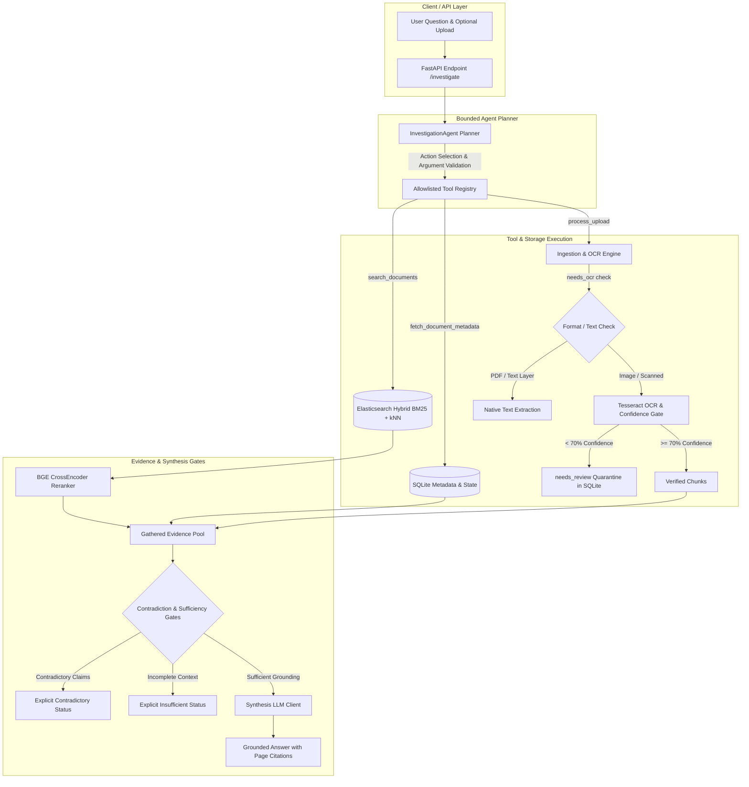

# System Design Document: AI Investigation Agent

## 1. System Goals & Problem Statement

The investigation agent investigates user questions using a standing knowledge corpus and newly introduced documents. Unlike conventional static RAG chatbots, the system operates as a bounded agent:
- Determines information requirements dynamically.
- Selects actions from an allowlisted tool registry.
- Decides whether newly uploaded documents require OCR or in-memory extraction.
- Detects contradictions across multiple documents.
- Explicitly abstains (`status: "insufficient"`) or reports conflicts (`status: "contradictory"`) instead of hallucinating.

---

## 2. Architecture Diagram

---

## 3. Modular Architecture Layers

### Layer 1: Ingestion & Document Intelligence
- **File Validation & SHA-256 Hashing**: Prevents re-processing identical files (`UNIQUE(content_hash)` in SQLite).
- **Format Routing**: `.txt`, `.md`, `.csv` use native UTF-8 extraction. PDFs check for existing text layers via PyMuPDF (`fitz`). Scanned pages and image files (`.png`, `.jpg`) route to Tesseract OCR.
- **Confidence Gating**: Averages word-level OCR confidence. Pages scoring $< 70\%$ are quarantined (`needs_review=1`), withheld from the vector search index, and excluded from verified evidence pools.
- **On-Demand Intelligence**: The planner can choose whether to index an uploaded document for general retrieval or extract it in-memory for instant answering.

### Layer 2: Evidence-Aware Retrieval
- **Hybrid Retrieval**: Combines Elasticsearch 8 dense vector kNN search (`BAAI/bge-small-en-v1.5`, 384 dims) with BM25 lexical keyword matching (`match` on chunk text).
- **BGE CrossEncoder Reranking**: Uses `BAAI/bge-reranker-base` to evaluate deep cross-attention relevance between the question and retrieved chunks.
- **Citation Preservation**: Every retrieved chunk preserves `doc_id`, `filename`, `source`, and `page_number`.

### Layer 3: Bounded Agent Planner
- **Tool Allowlist**: Restricts actions strictly to:
  1. `search_documents(query: str, top_k: int)`
  2. `fetch_document_metadata(document_id: str)`
  3. `process_upload(index_document: bool)`
  4. `finish()`
- **Loop Bounding & Repeat Protection**: Actions and arguments are validated against strict JSON schemas. Repeated identical queries are capped, and total loop executions are bounded by `agent_max_steps`. Document text is explicitly tagged as untrusted context to prevent prompt injection.

### Layer 4: Evidence Gates & LLM Synthesis
- **Contradiction Detection**: Multi-source claims (such as incident duration reports or SLA eligibility terms) are evaluated. If conflicting claims exist across distinct documents, the system halts with `CONTRADICTORY` status.
- **Abstention Policy**: If evidence confidence $< 0.55$ or required information is missing, the agent returns `INSUFFICIENT` with explicit missing information categories rather than generating speculative responses.

### Layer 5: Persistence
- **SQLite (`data/app.db`)**: Tracks document registration, processing states (`registered`, `processing`, `indexed`, `needs_review`, `failed`), and page-level metadata.
- **Elasticsearch (`document_chunks`)**: Stores dense vector embeddings, chunk text, and searchable metadata.

---

## 4. Failure Modes & Reliability

| Failure Mode | Mitigation Strategy |
| :--- | :--- |
| **Malformed LLM Output** | Retried up to `llm_repair_retries` with JSON schema enforcement; raises `PlannerValidationError` if unrepairable. |
| **Duplicate Uploads** | Byte-level SHA-256 check returns existing document ID and skips redundant OCR/indexing. |
| **Interrupted Processing** | `reset_stale_processing(older_than_seconds=300)` identifies documents stuck in `processing` and resets them to `registered` for retry. |
| **Degraded / Blurry Scans** | OCR scores below threshold (70%) are quarantined in SQLite with `needs_review=1` and barred from Elasticsearch indexation. |
| **Repeated Tool Calls** | Call signatures (`action + arguments`) are counted; loops beyond threshold automatically transition to gathered evidence evaluation. |

---

## 5. Scaling to Concurrent Users & Large Document Collections

To support high concurrency and collections spanning millions of pages, the system is architected for the following enhancements:

1. **Decoupled Asynchronous Worker Queues**:
   - Offload PyMuPDF rendering, Tesseract OCR, and embedding computation from FastAPI to an asynchronous task queue (Celery or ARQ backed by Redis).
   - FastAPI endpoints immediately return job tracking IDs, with WebSockets or polling for status updates.

2. **Database Concurrency & Multi-Tenancy**:
   - Replace single SQLite file with PostgreSQL for multi-worker connection pooling.
   - Introduce `tenant_id` and `user_id` columns on document and page tables for strict data isolation.

3. **Elasticsearch Index Scaling**:
   - Partition indexes by tenant or domain collection (`chunks_tenant_{id}`).
   - Utilize multi-stage retrieval: coarse BM25 + kNN HNSW vector search to fetch top 50 candidates, followed by BGE CrossEncoder reranking on the top 10.
